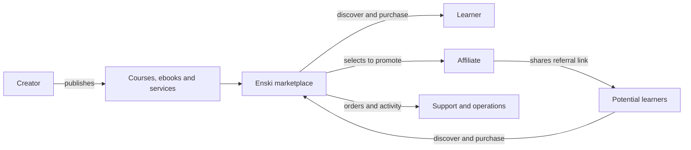
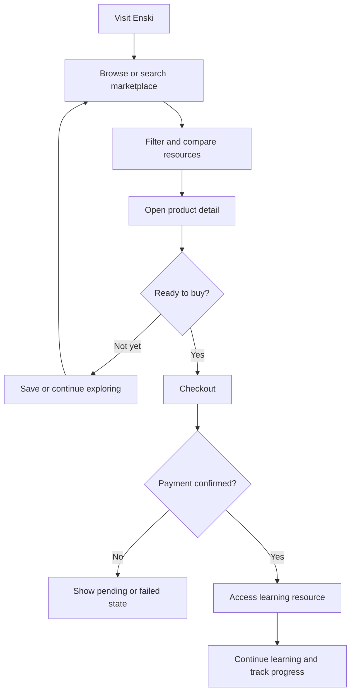
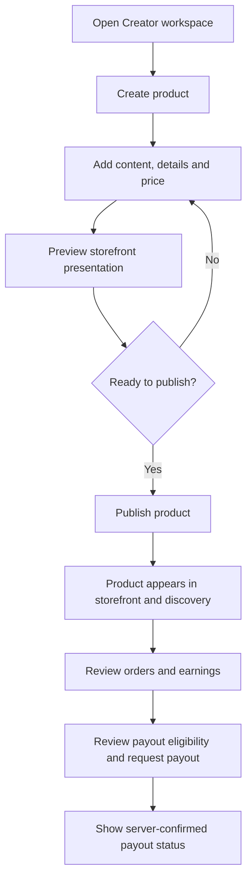
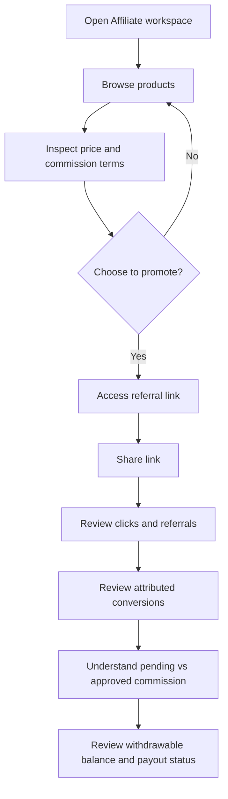

# Enski — product journeys

These diagrams describe the intended product model based on the current route structure and supplied interface screenshots. They are journey hypotheses, not proof that every step is implemented or connected to production services.

## Ecosystem overview

## Learner journey

## Creator journey

## Affiliate journey

## Cross-journey requirements

- Keep role-specific tasks clear while using a shared visual and navigation language.
- Show users what happens next after every important action.
- Treat checkout, commission and payout states as server-confirmed facts.
- Explain metric definitions and eligibility rules in context.
- Design empty, loading, error, success, offline and permission-denied states.
- Test complete mobile and desktop journeys, not isolated screens only.

## Validation

Test each journey with representative users. Record task success, confusion, errors, time on task and qualitative feedback. Update these diagrams when evidence or business rules change.
